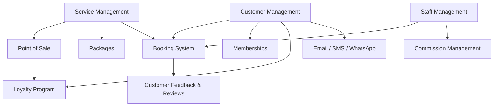

# SAAS MODULE DEPENDENCY MATRIX & FALLBACK SPECIFICATION

**Project:** Salon & Barber SaaS Application  
**Date:** November 25, 2026  
**Audited Service:** `App\Services\ModuleEntitlementService`

---

## 1. Cross-Module Dependency Rules

Independent modules must remain fully operational when an optional module is unavailable. Conversely, dependent modules must gracefully restrict only dependent actions without crashing the application.

---

## 2. Dependency Audit & Fallback Specification

### 2.1 Multi-Branch Management (`branches`)
- **Required Dependencies:** None.
- **Dependent Features:** Branch-specific appointments, branch staff schedules, branch stock, branch switcher dropdown.
- **Fallback Behavior When Unavailable / Disabled:**
  - The application automatically defaults to single-salon mode using the primary branch (`orderBy('id')->first()`).
  - The branch switcher in [top-header.blade.php](file:///c:/Ketan/projects/barber/resources/views/components/layout/top-header.blade.php), [navigation.blade.php](file:///c:/Ketan/projects/barber/resources/views/layouts/navigation.blade.php), and [branch-switcher.blade.php](file:///c:/Ketan/projects/barber/resources/views/components/branch-switcher.blade.php) is completely hidden.
  - [SetBranchContext.php](file:///c:/Ketan/projects/barber/app/Http/Middleware/SetBranchContext.php) clears `session('current_branch_id')` and locks container binding `app('current_branch')` to the primary branch.
  - Normal bookings, POS, staff management, and inventory operate in single-branch mode without disruption.

### 2.2 Inventory Management (`inventory`)
- **Required Dependencies:** None.
- **Dependent Features:** Stock alerts, product purchase orders, barcode scanning, POS product sales, backbar usage.
- **Fallback Behavior When Unavailable / Disabled:**
  - POS terminal restricts the cart to Services and Packages; the "Products" tab is hidden.
  - Inventory reports and sidebar links are removed.
  - Direct routes `/admin/inventory/*` return `403 Forbidden`.
  - Service-only checkouts proceed normally.

### 2.3 Point of Sale (`pos`)
- **Required Dependencies:** `services` (at least basic service catalog must exist).
- **Optional Integrations:** `inventory`, `packages`, `memberships`, `commissions`, `loyalty`.
- **Fallback Behavior When Optional Integrations are Unavailable:**
  - If `inventory` disabled: POS product item search is hidden; service checkout remains 100% active.
  - If `packages` disabled: Package redemption tab is hidden; normal cart checkout remains active.
  - If `memberships` disabled: Membership discount redemption is skipped; regular discounts and sales function.
  - If `commissions` disabled: POS sale records transactions cleanly without queuing commission calculation jobs.
  - If `loyalty` disabled: Loyalty points badge and redemption toggle are hidden from the POS checkout drawer.

### 2.4 Booking System (`appointments`)
- **Required Dependencies:** `services`, `staff`, `customers`.
- **Optional Integrations:** `branches`, `marketing`, `sms`, `whatsapp`, `feedback`.
- **Fallback Behavior When Optional Integrations are Unavailable:**
  - If `branches` disabled: All appointments default to the salon's primary location.
  - If notification modules disabled: Appointments confirm and save to the database cleanly; notifications are silently skipped with an info log entry rather than throwing email/SMS gateway exceptions.
  - If `feedback` disabled: Appointment completes normally without generating rating tokens or appending rating links.

### 2.5 Commission Management (`commissions`)
- **Required Dependencies:** `staff`.
- **Dependent Features:** Staff commission profiles, commission calculations, payout reports.
- **Fallback Behavior When Unavailable / Disabled:**
  - Staff management remains fully operational (schedules, attendance, appointments).
  - Commission links and reports are hidden.
  - No commission statements or ledger entries are recorded.

### 2.6 Packages (`packages`)
- **Required Dependencies:** `services`.
- **Dependent Features:** Package purchasing, multi-session package booking, POS package redemption.
- **Fallback Behavior When Unavailable / Disabled:**
  - Package menus and POS tabs are hidden.
  - Existing customer package balances remain safely stored in the database for future reactivation.

### 2.7 Memberships (`memberships`)
- **Required Dependencies:** `customers`.
- **Dependent Features:** Recurring memberships, customer tier benefits, POS membership discounts.
- **Fallback Behavior When Unavailable / Disabled:**
  - Membership menus and POS tabs are hidden.
  - Existing memberships remain preserved in storage without calculating discounts on new checkouts.

### 2.8 Customer Feedback & Reviews (`feedback`)
- **Required Dependencies:** `appointments`.
- **Dependent Features:** Completion email rating links, guest review submission form, admin reviews dashboard.
- **Fallback Behavior When Unavailable / Disabled:**
  - "Feedback & Reviews" sidebar item is hidden.
  - Completion emails omit the 5-star call-to-action button.
  - Customer dashboard omits the feedback modal popup.

### 2.9 Loyalty Program (`loyalty`)
- **Required Dependencies:** `customers`, `pos`.
- **Dependent Features:** Points ledger, checkout redemption, customer dashboard loyalty balance widget.
- **Fallback Behavior When Unavailable / Disabled:**
  - POS checkout omits the loyalty points redemption section.
  - Customer dashboard omits the loyalty rewards card.
  - Customer points balance is preserved in the database.
