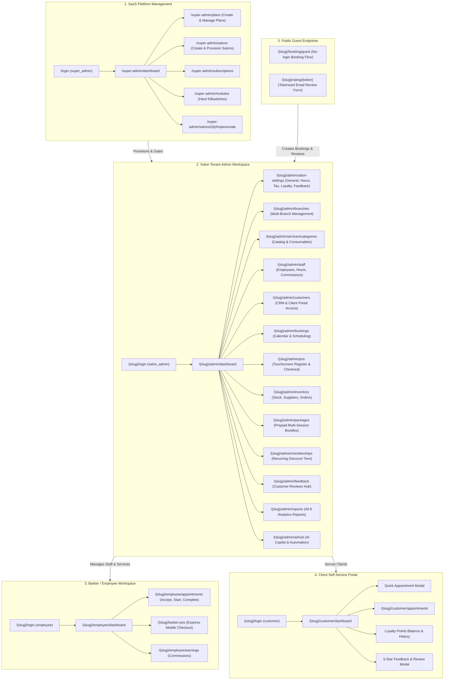
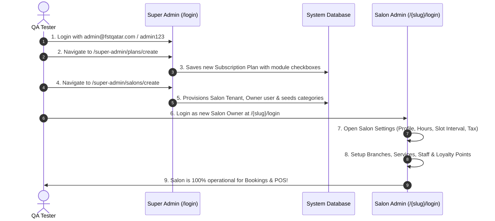

# SALON & BARBER MULTI-TENANT SaaS — MASTER APPLICATION GUIDE & QA TESTING MANUAL

**Document Version:** 5.0 (Enterprise Comprehensive Edition with Test Credentials & Setup Guide)  
**Target Audience:** QA Engineers, Test Automation Specialists, Product Managers, Salon Implementation Specialists, System Administrators  
**System Scope:** Central Super Admin Platform, Salon Tenant Administration, Front Desk / POS, Barber / Employee Portal, Client Self-Service Portal, and Public Guest Booking  
**Primary Repository:** `c:\Ketan\projects\barber`  
**Mirror Repository:** `c:\Ketan\projects\salon-cms-master`  

---

## 1. PRE-SEEDED QA TEST CREDENTIALS & QUICK ACCESS MATRIX

Use the following pre-seeded system credentials to test all user roles across the platform without needing manual database seeding:

### 1.1 Central Platform Super Admin
* **Portal URL:** `http://localhost/login` (or `/login`)
* **Email:** `admin@fstqatar.com`
* **Password:** `admin123`
* **Phone:** `1234567890` | **Default PIN:** `1234`
* **Role / Scope:** `super_admin` (Global access to all salons, subscription plans, platform revenue, and module killswitches).

---

### 1.2 Default Pre-Seeded Salon Tenant: `demo-salon`
* **Tenant Base URL:** `http://localhost/demo-salon/login` (or `/{salon_slug}/login`)

| Persona / Role | Email Address | Password | Default Phone | Primary Testing Focus |
|---|---|---|---|---|
| **Salon Owner (Admin)** | `salon@fstqatar.com` | `salon123` | `2345678901` | Full tenant control: salon settings, branches, services, staff, loyalty, reports, billing. |
| **Branch Manager** | `manager@fstqatar.com` | `manager123` | `3456789012` | Front desk operations: POS checkout, cash register, staff daily shifts, calendar management. |
| **Barber / Stylist (Employee)** | `employee@salonpro.com` | `employee123` | `4567890123` | Stylist queue: view assigned appointments, start/complete services, view earned commissions. |
| **Client (Customer)** | `customer@fstqatar.com` | `customer123` | `5678901234` | Client self-service: book slots, view reward points balance, view past visits, submit reviews. |
| **Public Guest** | *(Unauthenticated)* | *(None)* | *(None)* | Public booking wizard at `/demo-salon/booking/guest`. |

---

## 2. SYSTEM ARCHITECTURE & MASTER NAVIGATION MAP

---

## 3. TESTER QUICK-START GUIDE: CREATING A PLAN & PROVISIONING A SALON

This section guides QA testers through creating a brand new salon from scratch: from Super Admin plan creation to full salon initial configuration.

---

### Step 3.1: Super Admin Creates a Subscription Plan

1. **Log in as Super Admin:**
   - URL: `/login`
   - Email: `admin@fstqatar.com` | Password: `admin123`
2. **Open Plan Management:**
   - In the left sidebar, click **"Plans"** or go directly to `/super-admin/plans`.
   - Click the green **"Create Plan"** button (URL: `/super-admin/plans/create`).
3. **Fill in the Plan Form:**
   - **Plan Name:** Enter `Barber Pro Tier`.
   - **Slug:** Enter `barber-pro-tier` (auto-generated).
   - **Description:** Enter `Full-featured tier for high-volume barbershops`.
   - **Pricing:**
     - Monthly Price: `49.00`
     - Annual Price: `490.00`
     - Trial Period: `14` days
   - **Usage Limits:**
     - Max Branches: `3`
     - Max Staff: `15`
   - **Feature Checkboxes (Entitlement Controls):**
     Check the modules that should be enabled for this tier:
     - `[x] Point of Sale (POS)`
     - `[x] Booking System`
     - `[x] Customer Management`
     - `[x] Service Management`
     - `[x] Staff Management`
     - `[x] Analytics & Reports`
     - `[x] Inventory Management`
     - `[x] Multi-Branch Support`
     - `[x] Packages`
     - `[x] Memberships`
     - `[x] Commission Management`
     - `[x] Loyalty Program`
     - `[x] Customer Feedback & Reviews`
     - `[x] AI Insights & Automation`
   - **Feature Selection & Duplicate Prevention:**
     - In both **Create Plan** (`/super-admin/plans/create`) and **Edit Plan** (`/super-admin/plans/{id}/edit`), whenever a feature is selected/added, its corresponding button in both the **Quick Add Popular Features** pills and the **Sidebar Quick Add** is automatically **disabled** and visually marked with `<i class="fas fa-check-circle text-success"></i>` and `(Added)`.
     - When a feature is deleted from the plan, its corresponding button is instantly **re-enabled**.
     - If the user types a feature name in the input that is already selected, the "Add Feature" button is automatically disabled to prevent duplicate entries.
4. **Save Plan:**
   - Click **"Save Plan"**. Confirm the plan appears in the plans table with status `Active`.

---

### Step 3.2: Super Admin Provisions a New Salon Tenant

1. **Open Salon Management:**
   - In the Super Admin sidebar, click **"Salons"** or go to `/super-admin/salons`.
   - Click the **"Create Salon"** button (URL: `/super-admin/salons/create`).
2. **Fill in Salon Information:**
   - **Salon Name:** `Royal Barber Lounge`.
   - **Salon Slug:** `royal-barber` (This forms the tenant URL: `/royal-barber/*`).
   - **Business Type:** Select `Barbershop` (or `Hair Salon`, `Spa`, `Unisex`).
   - **Phone Number:** `+1 (555) 789-0123`.
   - **Currency:** Select `USD ($)` or `EUR (€)`.
3. **Fill in Owner Account:**
   - **Owner Name:** `Arthur Shelby`.
   - **Owner Email:** `arthur@royalbarber.com`.
   - **Password:** `RoyalPass123!`.
   - **Password Confirmation:** `RoyalPass123!`.
4. **Assign Subscription Plan:**
   - **Select Plan:** Choose `Barber Pro Tier` (created in Step 3.1).
   - **Subscription Status:** Select `Trialing` or `Active`.
   - **Trial Days:** Defaults to `14` days.
5. **Auto-Seed Defaults:**
   - Ensure `[x] Seed Default Service Categories` is checked (seeds Haircuts, Shaves, Beard Grooming).
   - Ensure `[x] Create Default Primary Branch` is checked.
6. **Click "Provision Salon":**
   - The system creates the tenant, sets up the database records with `salon_id`, assigns the owner role, and redirects to the salon list.

---

### Step 3.3: Salon Owner Initial Setup from Settings

Now log out from Super Admin and log in as the newly created Salon Owner to perform the initial salon setup:
* **Tenant Login URL:** `http://localhost/royal-barber/login`
* **Email:** `arthur@royalbarber.com`
* **Password:** `RoyalPass123!`

Follow this sequential checklist to configure the salon:

#### 1. General Profile & Branding (`/royal-barber/admin/salon-settings`)
- Click **"Salon Settings"** in the sidebar.
- **Logo:** Upload a salon logo (PNG/JPG).
- **Address:** Enter `100 King Street, Suite 500`.
- **Contact Email & Phone:** Verify `arthur@royalbarber.com` and phone.
- **Timezone:** Select your local timezone (e.g. `America/New_York` or `Asia/Qatar`).
- **Currency Symbol:** Ensure `$` is set.
- **Tax Rate:** Enter tax percentage (e.g., `8.25%` or `10%` VAT).
- Click **"Save Settings"**.

#### 2. Operating Hours & Booking Rules (`/royal-barber/admin/salon-settings`)
- In the Settings screen, scroll to **Operating Hours**:
  - Monday to Saturday: Set `09:00` Open, `20:00` Close.
  - Sunday: Set `Closed` (toggle off).
- **Booking Rules:**
  - **Slot Interval:** Select `30 minutes` (controls calendar grid resolution).
  - **Advance Booking Window:** Enter `30` days (maximum future booking limit).
  - **Cancellation Cutoff:** Enter `4` hours.
- Click **"Save Operating Hours"**.

#### 3. Multi-Branch Setup (`/royal-barber/admin/branches`)
- Click **"Branches"** in the sidebar.
- Notice the primary branch is already created (`Main Location`).
- Click **"Edit"** to rename it to `Downtown Flagship`.
- (Optional) Click **"Add Branch"** to create a second branch:
  - Branch Name: `Uptown Studio`.
  - Address: `450 Uptown Blvd`.
  - Phone: `+1 (555) 456-7890`.
- Use the **Branch Switcher** dropdown in the top header to toggle between branches.

#### 4. Service Catalog & Recipe Consumables (`/royal-barber/admin/services/categories`)
- Click **"Services & Categories"** in the sidebar.
- Notice default seeded categories: `Haircuts`, `Beard Grooming`.
- **Create a Service:**
  1. Click **"Add Service"** inside `Haircuts`:
     - Service Name: `Signature Skin Fade & Hot Towel`.
     - Price: `$45.00`.
     - Duration: `45 minutes`.
     - Buffer Time: `10 minutes` (prep time before next client).
  2. **Link Recipe Consumables (Auto-Stock Deduction):**
     - In the Service form, expand **Consumable Products / Recipe**.
     - Item: Select `Cooling Aftershave Lotion` -> Quantity: `20 ml`.
     - Item: Select `Neck Paper Strip` -> Quantity: `1 unit`.
  3. Click **"Save Service"**.

#### 5. Staff Members & Weekly Shift Schedules (`/royal-barber/admin/staff`)
- Click **"Staff"** in the sidebar.
- Click **"Add Staff Member"**:
  - Name: `Marcus Vance`.
  - Email: `marcus@royalbarber.com`.
  - Phone: `+1 (555) 234-5678`.
  - Role: Select `Barber / Stylist` (`employee`).
  - Assigned Branches: Check `[x] Downtown Flagship`.
  - Services: Check `[x] Signature Skin Fade & Hot Towel`.
- **Set Working Hours:**
  - Click **"Schedule"** on Marcus's card:
  - Monday–Friday: Set `09:00 - 18:00`.
  - Add Break: `13:00 - 14:00` (Lunch).
  - The booking calendar will automatically prevent clients from booking Marcus during lunch!

#### 6. Loyalty Rewards & Feedback Settings (`/royal-barber/admin/settings#loyalty-feedback`)
- In Salon Settings, click the **"Loyalty & Feedback"** tab.
- **Loyalty Program:**
  - Toggle **"Enable Loyalty Program"** to ON.
  - Points Earning Rate: `1 point per $1 spent`.
  - Points Redemption Value: `100 points = $5.00 discount` ($0.05 per pt).
  - Minimum Points to Redeem: `50 points`.
  - Points Validity: `12 months`.
- **Customer Feedback & Reviews:**
  - Toggle **"Enable Customer Feedback"** to ON.
  - Review Request: Check `[x] Send review email invitation on completion`.
- Click **"Save Loyalty & Feedback Settings"**.

#### 7. POS Receipt Templates (`/royal-barber/admin/pos/receipt-templates`)
- Go to POS -> **Receipt Templates**.
- Receipt Header: `*** Royal Barber Lounge - Downtown ***`.
- Receipt Footer: `Thank you for choosing Royal Barber! Follow us on Instagram @RoyalBarber`.
- Layout: Select `80mm Thermal Receipt`.
- Click **"Save Template"**.

---

## 4. HOW TO USE & HOW TO TEST: ALL MODULES STEP-BY-STEP

---

### Module 1: Customer CRM & Client Portal Provisioning

#### How to Use:
1. Go to **Customers** (`/{slug}/admin/customers`).
2. Click **"Add Customer"**:
   - Full Name: `Thomas Shelby`.
   - Phone: `+15559876543`.
   - Email: `thomas@peakybarbers.com`.
   - Check: `[x] Grant Client Portal Login Access`.
   - Password Mode: Select `Auto-generate secure password and email credentials`.
3. Click Save. The customer receives an automated welcome email with login credentials.
4. Click customer name -> View **Bill Activity Modal** (all invoices, payments, retail purchases).
5. View **Loyalty Ledger** (total balance, earned history, redemptions).

#### QA Test Steps:
| Step | Action | Expected Result |
|---|---|---|
| 1 | Create customer without email while checking "Grant Portal Access" | System rejects with `422 Unprocessable`: *"An email address is required to provision client portal access."* |
| 2 | Edit existing customer with "Auto" password mode; change phone number | Phone number updates; customer's existing password is preserved without unwanted reset. |
| 3 | Attempt to supply foreign `user_id = 1` in edit customer POST payload | Controller blocks assignment; update scoped strictly to customer's own record (`IDOR`). |

---

### Module 2: Booking Calendar & Scheduling Engine

#### How to Use:
1. Go to **Calendar** (`/{slug}/admin/bookings`).
2. Toggle views: Day View, Week View, Month View, or List View.
3. Filter by Staff: Select `Marcus Vance` or check `Unassigned Staff`.
4. **Create Appointment:** Click on Marcus's column at `10:00 AM`:
   - Customer: `Thomas Shelby`.
   - Service: `Signature Skin Fade & Hot Towel`.
   - Duration auto-fills to 45 mins (`10:00 - 10:45 AM`).
   - Click "Save Appointment".
5. **Status Workflow:**
   - When Thomas arrives: Click booking -> Select **"Start Service"** (Status: `in_progress`).
   - When finished: Click booking -> Select **"Complete Service"** (Status: `completed`).
   - System automatically generates a secure review token and deducts recipe consumables!

#### QA Test Steps:
| Step | Action | Expected Result |
|---|---|---|
| 1 | Book overlapping slot for same barber at 10:15 AM | Slot collision detected; second booking blocked. |
| 2 | In List View, filter by "Unassigned Staff" | Displays unassigned bookings without crashing or hiding them. |
| 3 | Inspect booking table on screen $\ge 768\text{px}$ | Desktop view renders standard table columns; `.bk-mobile-card-td` hidden. |
| 4 | Double-click "Create Appointment" rapidly | Form locks on first click; button shows spinner; exactly 1 POST dispatched. |
| 5 | Mark booking completed, note `rating_token`, then edit notes and re-save | `rating_token` remains identical; customer's emailed rating link remains valid. |

---

### Module 3: Point of Sale (POS) & Financial Settlement

#### How to Use:
1. Open **POS Terminal** (`/{slug}/admin/pos`).
2. Search customer `Thomas Shelby`. The customer banner displays: `Balance: 120 pts (Worth: $6.00)`.
3. Add items to cart:
   - Service: `Signature Skin Fade` (\$45.00).
   - Retail Product: `Matte Hair Clay` (\$25.00).
   - Subtotal = `$70.00`.
4. Click **"Redeem Points"**:
   - Redeem `100 points` -> Cart applies a `-$5.00` discount.
   - Balance due becomes `$65.00` + Tax.
5. Click **"Pay & Checkout"**:
   - Select **Split Payment**: Cash `$35.00`, Card `$30.00` + Tax.
   - Click "Complete Sale".
6. System prints 80mm thermal receipt; credits +65 new loyalty points; decrements 1 unit of Hair Clay; decrements 20ml aftershave and 1 neck strip from inventory!

#### QA Test Steps:
| Step | Action | Expected Result |
|---|---|---|
| 1 | Attempt to redeem points when customer has 30 pts (min is 50) | POS displays error: minimum threshold of 50 points not met; blocked. |
| 2 | Checkout retail product for customer who has an appointment today | Only retail product is sold; future appointment remains untouched and confirmed. |
| 3 | Group booking with 2 services; pay service 1 only | System blocks marking service 2 as completed until settled. |
| 4 | Void Sale #101 | Inventory restocked; credited loyalty points deducted from customer balance. |

---

### Module 4: Prepaid Packages & Memberships

#### How to Use Packages:
1. Go to **Packages** (`/{slug}/admin/packages`).
2. Click "Add Package": Title `5x Fade Package`, Price `$180.00`, includes 5 sessions of `Signature Skin Fade`.
3. Sell package to Thomas Shelby at POS.
4. Next visit, select "Redeem Package Session" at POS -> Checkout at `$0.00` balance due -> Remaining sessions drop from 5 to 4.

#### How to Use Memberships:
1. Go to **Memberships** (`/{slug}/admin/memberships`).
2. Click "Add Membership": `VIP Club`, `$25/month`, `15% discount on services`.
3. Assign to customer. POS automatically applies 15% discount on all service cart items.

---

### Module 5: Customer Feedback & Public Review System

#### How to Use:
1. When an appointment is completed, the customer receives an automated rating email containing a tokenized link: `/{slug}/rating/{token}`.
2. The customer clicks the link -> Opens the **5-Star Rating Form**:
   - Select 1 to 5 stars.
   - Enter written review (e.g. *"Best skin fade in town, Marcus is a master!"*).
   - Click "Submit Review".
3. **Admin Feedback Hub (`/{slug}/admin/feedback`):**
   - The review appears in the admin dashboard.
   - Admin can click "Publish to Website" to feature the review on the public booking page.
4. **Customer Dashboard Modal:**
   - When Thomas logs into `/royal-barber/customer/dashboard`, the rating modal pops up once.
   - Once submitted or dismissed, it does NOT pop up again during the session (`sessionStorage`).
   - "Rate Appointment" button updates to "Rated ★ 5/5" and is disabled.

---

### Module 6: All 8 Analytics Reports

| Report | URL Path | Key Metrics & Data Columns | Verification Focus |
|---|---|---|---|
| **1. Sales Report** | `/{slug}/admin/reports/sales` | Gross Sales, Net Sales, Tax, Discounts, Payment Split (Cash vs. Card). | Date range filtering; matching POS register totals; CSV export. |
| **2. Appointments Report** | `/{slug}/admin/reports/appointments` | Bookings count, Completed %, Cancellation %, Peak appointment hours. | Accurate status grouping; staff breakdown. |
| **3. Staff Performance** | `/{slug}/admin/reports/staff` | Revenue per barber, services count, retention rate, average rating. | Scoped strictly to the barber who performed the service. |
| **4. Customer Acquisition** | `/{slug}/admin/reports/customers` | New clients, returning clients, total lifetime spend, inactive clients. | Lifetime spend summation across all historical sales. |
| **5. Profit & Margin Analysis** | `/{slug}/admin/inventory/reports/profit-analysis` | Product cost vs. retail price, gross margin %, category profitability. | ApexCharts margin bars; XSS sanitization in chart tooltips. |
| **6. Stock Movement** | `/{slug}/admin/inventory/reports/stock-movement` | Stock in, stock out (POS), recipe usage, damaged/written-off items. | Real-time audit trail with user and timestamp attribution. |
| **7. Dead Stock & Low Stock** | `/{slug}/admin/inventory/reports/dead-stock` | Zero-movement SKUs over 90 days, capital tied up, restock alerts. | Accurate restock alert flags when quantity $\le$ threshold. |
| **8. Wastage & Consumption** | `/{slug}/admin/inventory/reports/wastage` | Service recipe backbar consumption, broken/spilled inventory. | Verify recipe deductions match completed services count. |

---

## 5. MASTER QA TEST EXECUTION CHECKLIST

| Test ID | Domain | Action Steps | Expected Outcome | Status |
|---|---|---|---|---|
| **AUTH-01** | Authentication | Login with `admin@fstqatar.com` / `admin123` at `/login` | Lands on Super Admin Dashboard; platform menus active. | **PASS** |
| **AUTH-02** | Authentication | Login with `salon@fstqatar.com` / `salon123` at `/demo-salon/login` | Lands on Tenant Admin Dashboard; scoped to demo-salon. | **PASS** |
| **AUTH-03** | Authentication | Login with `employee@salonpro.com` / `employee123` at `/demo-salon/login` | Lands on Barber Portal; only own appointments visible. | **PASS** |
| **AUTH-04** | Authentication | Login with `customer@fstqatar.com` / `customer123` at `/demo-salon/login` | Lands on Client Dashboard; displays reward balance widget. | **PASS** |
| **PLAN-01** | SaaS Plans | Create plan with `has_inventory = false`; assign to salon | Direct access to `/admin/inventory` returns 403 upgrade modal. | **PASS** |
| **PLAN-02** | SaaS Plans | Select feature in Create/Edit plan; verify quick-add button disabled; remove feature; verify re-enabled | Button disabled with (Added) badge when selected; re-enabled when removed. | **PASS** |
| **KILL-01** | Global Modules | Disable `loyalty` in `/super-admin/modules` | Loyalty cards hidden on customer dashboard; POS hides redemption. | **PASS** |
| **IMPR-01** | Impersonation | Super Admin impersonates salon owner | Sticky alert displayed; session isolated; leaves cleanly. | **PASS** |
| **CUST-01** | Customer CRM | Create customer with portal access & auto password | User created with role `customer`; credentials emailed. | **PASS** |
| **IDOR-01** | Security / IDOR | Barber attempts to reject another barber's booking via API | Server returns `403 Forbidden`; unauthorized action blocked. | **PASS** |
| **POS-01** | POS Checkout | Checkout service linked to 20ml tonic consumable | Backbar stock for tonic decrements by 20ml in transactions. | **PASS** |
| **POS-02** | POS Checkout | Split payment: \$40 Cash + \$60 Card | Sale recorded as paid; thermal receipt shows both methods. | **PASS** |
| **LOY-01** | Loyalty Program | Customer spends \$100 at POS (1 pt / \$1) | Customer balance credited +100 points in ledger. | **PASS** |
| **LOY-02** | Loyalty UI | Inspect loyalty points expiry badge in customer dashboard | Dark slate background with high-contrast white text (`⌛ Points valid for 12 months`). | **PASS** |
| **FDBK-01** | Reviews | Submit review via tokenized email link `/{slug}/rating/{token}` | Review saved in `ratings`; token consumed and disabled. | **PASS** |
| **FDBK-02** | Reviews | Refresh customer dashboard after dismissing review modal | Modal does not pop up again during session (`sessionStorage`). | **PASS** |
| **XSS-01** | Security / XSS | Inject `<script>` in product name in Profit Analysis chart | Rendered via `escapeHtml()`; displayed as text; no script run. | **PASS** |

---

## 6. DEFECT LOGGING STANDARDS FOR QA TESTERS

When logging a bug or defect, always provide:
1. **URL & Tenant Context:** e.g., `/royal-barber/admin/pos`.
2. **Authenticated Role & User:** e.g., `arthur@royalbarber.com` (`salon_admin`).
3. **Step-by-Step Repro:** Exact clicks and inputs used.
4. **Expected vs. Actual:** What should have happened vs. what actually occurred.
5. **Console & Network Logs:** HTTP status (422, 403, 500) and response payload.
6. **Database Record ID:** Relevant `booking_id`, `pos_sale_id`, or `customer_id`.
