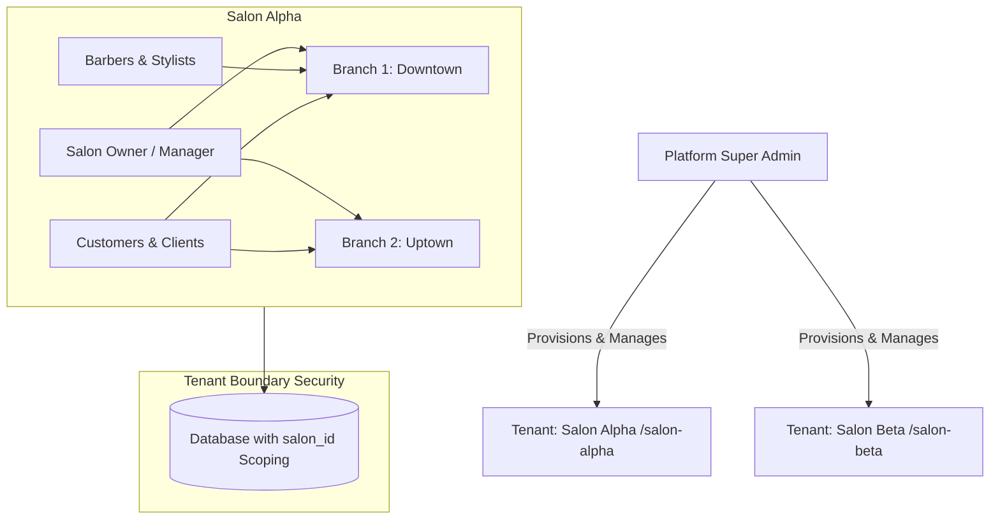

# SALON & BARBER MULTI-TENANT SaaS — QA TESTING MANUAL & END-TO-END APPLICATION GUIDE

**Document Version:** 3.0 (Enterprise Production Manual)  
**Target Audience:** QA Engineers, Test Automation Specialists, Product Managers, Salon Implementation Specialists  
**Scope:** Super Admin Platform, Tenant Administration, Front Desk / POS, Barber Portal, and Customer Client Portal  

---

## 1. APPLICATION ARCHITECTURE & MULTI-TENANT MODEL

### 1.1 Multi-Tenant Isolation Hierarchy
The application operates as a multi-tenant Software-as-a-Service (SaaS) suite. Every salon represents an independent tenant with strictly isolated data:
1. **URL Routing Isolation:**
   - Super Admin: `/super-admin/...` (Central platform control)
   - Tenant Admin: `/{salon_slug}/admin/...`
   - Staff / Barber Portal: `/{salon_slug}/employee/...` & `/{salon_slug}/barber-pos`
   - Customer Portal: `/{salon_slug}/customer/...` & `/{salon_slug}/booking/...`
2. **Database Scoping Boundary:**
   - Every operational model (Bookings, Customers, Invoices, POS Sales, Inventory, Loyalty, Services, Staff) uses the `BelongsToSalon` trait.
   - The Eloquent global scope automatically appends `WHERE salon_id = ?` to all SELECT, UPDATE, and DELETE queries based on the authenticated user's tenant.
3. **Branch Sub-Scoping:**
   - Large salons support multiple physical branches (`Branch` model).
   - Session variable `session('current_branch_id')` tracks the active branch for POS, bookings, and inventory stock.



---

## 2. USER PERSONAS & ROLE MATRIX

| Persona | Role Code | Access Level & Scope | Primary Responsibilities |
|---|---|---|---|
| **Super Admin** | `super_admin` | Global Central Platform | Manage SaaS subscription plans, global module switches, tenant creation, platform billing. |
| **Salon Owner** | `salon_admin` | Entire Tenant (`salon_id`) | Full control of salon: branches, services, staff, pricing, loyalty, reports, settings. |
| **Branch Manager** | `manager` | Single Branch Context | Front desk operations, POS checkout, cash drawer management, staff schedules. |
| **Barber / Stylist** | `employee` | Personal Appointments | View assigned queue, accept/reject bookings, mark completed, view commissions. |
| **Customer / Client** | `customer` | Self-Service Client Portal | Book online slots, view past services, review feedback, check loyalty reward balance. |

---

## 3. SAAS MODULE DIRECTORY & ENTITLEMENT GOVERNANCE

The application governs 18 functional modules through a strict 5-tier entitlement formula:
$$\text{Module Access} = \text{Global Enabled} \land \text{Plan Included} \land \text{Subscription Eligible} \land \text{Tenant Active} \land \text{Dependencies Met}$$

### 3.1 Module Directory
1. **Multi-Branch Management (`branches`):** Multi-location support, branch switching, branch-specific inventory and staff schedules.
2. **Inventory Management (`inventory`):** Stock items, supplier purchase orders, product sales, recipe/consumables auto-deduction.
3. **Point of Sale (`pos`):** Touchscreen POS register, split payments, barcode lookup, discounts, tips, tax rates, receipt printing.
4. **Booking System (`appointments`):** Multi-staff drag-and-drop calendar, slot capacity, online appointments, cancellation policies.
5. **Customer Management (`customers`):** Client CRM, notes, billing history, custom tags, portal credentials.
6. **Service Management (`services`):** Service categories, durations, buffer times, pricing tiers, assigned staff.
7. **Staff Management (`staff`):** Working hours, break times, attendance, access roles, performance metrics.
8. **Analytics & Reports (`reports`):** 8 dedicated reports (Sales, Appointments, Staff, Customers, Profitability, Inventory, Wastage).
9. **Packages (`packages`):** Prepaid multi-session bundled service packages.
10. **Memberships (`memberships`):** Recurring membership tiers with automated discount rates.
11. **Commission Management (`commissions`):** Tiered, flat, or percentage-based staff commission structures.
12. **Role Management (`roles`):** Custom role creation and granular permission toggles.
13. **Email Notifications (`marketing`):** Automated booking confirmation, reminders, completion emails, credentials delivery.
14. **SMS Notifications (`sms`):** Twilio/SMS gateway automated appointment alerts.
15. **WhatsApp Notifications (`whatsapp`):** WhatsApp Business API messaging.
16. **AI Insights & Copilot (`ai`):** Intelligent revenue forecasting, inventory restock suggestions, AI copilot.
17. **Loyalty Rewards Program (`loyalty`):** Points earned per currency spent, point redemption thresholds, point validity duration.
18. **Customer Feedback & Reviews (`feedback`):** Star ratings, customer review submission, admin testimonial publishing.

### 3.2 Graceful Fallback Rules When Modules Are Inactive
- If **`inventory`** is disabled: POS hides the Products tab; service checkouts operate without disruption.
- If **`branches`** is disabled: Application runs in single-salon mode; branch switcher dropdown is hidden.
- If **`loyalty`** is disabled: Customer dashboard hides reward cards; POS hides the points redemption button.
- If **`feedback`** is disabled: Completion emails omit rating links; customer dashboard suppresses review prompts.

---

## 4. END-TO-END WORKFLOWS (HOW TO USE THE APPLICATION)

```mermaid
sequenceDiagram
    autonumber
    actor Customer
    actor FrontDesk as Front Desk / POS
    actor Barber as Barber / Stylist
    actor Admin as Salon Admin

    Customer->>FrontDesk: 1. Books appointment online or walks in
    Admin->>FrontDesk: 2. Approves booking / assigns to Barber
    Barber->>Barber: 3. Accepts booking & performs service
    Barber->>FrontDesk: 4. Marks service completed
    FrontDesk->>FrontDesk: 5. Opens POS Checkout: adds products, applies loyalty points
    Customer->>FrontDesk: 6. Pays via Cash / Card / Split Payment
    FrontDesk->>Customer: 7. Prints Receipt; System awards Loyalty Points
    Customer->>Customer: 8. Receives completion email; rates appointment (1-5 stars)
    Admin->>Admin: 9. Views Review in Admin Feedback Hub & inspects Commission
```

### 4.1 Super Admin Onboarding & Plan Assignment
1. Login to Super Admin Portal: `/login` (with super_admin credentials).
2. Go to **Plans Management** (`/super-admin/plans`):
   - Create or edit a plan (e.g., "Barber Pro" at \$49/month).
   - Check included features (e.g., `Point of Sale (POS)`, `Booking System`, `Loyalty Program`, `Inventory Management`).
3. Go to **Salons Management** (`/super-admin/salons`):
   - Click "Create Salon". Fill in Salon Name (e.g., "Royal Barber Lounge"), custom slug (`royal-barber`), business type, and owner email.
   - Assign subscription plan or set trial end date.
4. Tenant workspace is now live at `/royal-barber/admin`.

### 4.2 Salon Admin Initial Configuration
1. Login at `/royal-barber/login` as Salon Admin.
2. **Branch Setup (`/royal-barber/admin/branches`):** Configure primary branch address, phone, and timezone.
3. **Staff Setup (`/royal-barber/admin/staff`):**
   - Add barbers/stylists. Set working hours (e.g., Mon-Sat 09:00 - 18:00) and service specialties.
4. **Service Catalog (`/royal-barber/admin/services`):**
   - Create categories (e.g., Haircuts, Beard Grooming).
   - Add services with duration (e.g., "Classic Fade", 30 mins, \$25.00).
5. **Loyalty & Feedback Settings (`/royal-barber/admin/settings#loyalty-feedback`):**
   - Toggle "Enable Loyalty Program" ON.
   - Configure: Earn 1 point per \$1 spent; 100 points = \$5 discount; Minimum 50 points to redeem; Expiration: 12 months.
   - Toggle "Enable Customer Feedback" ON.

### 4.3 Front Desk & Booking Lifecycle
1. Open Calendar: `/{salon_slug}/admin/bookings`.
2. Click on an empty time slot to open **Create Appointment**:
   - Select Customer (or create new with phone number).
   - Select Service and assigned Barber.
   - Click Save. Status is `confirmed`.
3. In **List View** or **Calendar View**, click the booking:
   - Click "Start Service" -> Status changes to `in_progress`.
   - Click "Complete Service" -> Status changes to `completed`.
   - System automatically generates a secure rating token for the customer.

### 4.4 Point of Sale (POS) Checkout
1. Open POS Terminal: `/{salon_slug}/pos`.
2. Search customer by name or phone:
   - Customer loyalty points balance is displayed in the header.
3. Add services or inventory retail products:
   - If customer has sufficient loyalty points, click "Redeem Points": enter points to redeem (e.g., 50 pts = \$2.50 discount).
4. Select payment method: Cash, Card, UPI, or Split Payment.
5. Click **Pay & Checkout**:
   - Invoice is recorded in database.
   - Consumables/backbar inventory is deducted according to service recipe.
   - Loyalty points earned are credited to customer ledger.
   - Thermal/A4 receipt is generated.

### 4.5 Customer Self-Service & Feedback Flow
1. Customer visits portal: `/{salon_slug}/customer/dashboard`.
2. Views:
   - Upcoming appointments and past completed visits.
   - **Reward Balance:** Current points, currency cash value, point validity duration.
   - **Transaction Ledger:** Date, sale reference, points earned/redeemed.
3. **Rating Appointment:**
   - Completed appointments show a "Rate Appointment" button.
   - Clicking opens the modal: select 1 to 5 stars, leave comments, click Submit.
   - Once submitted, button updates to "Rated (★ 5/5)" and is disabled.
   - Modal will not nag customer again on reload.

---

## 5. QA TEST SUITES & TEST CASES

### Suite 1: SaaS Platform & Subscription Feature Gating

| Test ID | Title | Pre-Conditions | Action Steps | Expected Result |
|---|---|---|---|---|
| **SAAS-01** | Provision New Salon Tenant | Super Admin logged in | Go to `/super-admin/salons/create`. Input name, slug `gentlemens-den`, owner email. Click Create. | Tenant is provisioned; database creates default branches; URL `/gentlemens-den/admin` is accessible. |
| **SAAS-02** | Plan Feature Gating (Inventory Lock) | Salon is on "Starter Plan" with `has_inventory = false` | Attempt to navigate to `/{slug}/admin/inventory` directly. | System returns 403 Forbidden with upgrade prompt modal; access is blocked. |
| **SAAS-03** | Super Admin Global Module Killswitch | Module `loyalty` is globally enabled | In `/super-admin/modules`, toggle `Loyalty Program` to Disabled. Navigate to tenant admin settings. | Loyalty tab in Settings and Customer Dashboard is completely hidden; API returns 403. |
| **SAAS-04** | Subscription Trial Expiration | Salon trial expired (`trial_ends_at < now()`) | Navigate to tenant dashboard. | System intercepts request with subscription expired screen; prompts for payment renewal. |
| **SAAS-05** | Cancelled Subscription Grace Period | Salon subscription cancelled with `ends_at` 15 days in future | Navigate to admin dashboard. | Full access is maintained until `ends_at` is reached; warning badge shows renewal reminder. |

---

### Suite 2: Multi-Branch & Tenant Isolation

| Test ID | Title | Pre-Conditions | Action Steps | Expected Result |
|---|---|---|---|---|
| **TENANT-01** | Cross-Tenant Direct Object Reference (IDOR) | Two salons exist: Slug A (`id=1`) and Slug B (`id=2`) | Logged in as Salon A Admin, attempt `GET /salon-a/admin/customers/{id_of_salon_b_customer}` | Query yields 404 Not Found due to `BelongsToSalon` global scope; no data leak. |
| **TENANT-02** | Cross-Tenant Package / Service Injection | Logged in as Salon A Admin | Send `POST /salon-a/admin/packages` with `services=[id_of_service_in_salon_b]` | Request fails with 422 Unprocessable Entity; cross-tenant service injection blocked. |
| **TENANT-03** | Multi-Branch Context Switch | Salon has 2 branches: "Downtown" and "Airport" | Click Branch Switcher dropdown; select "Airport". Add booking. | Booking is assigned to Airport branch ID; session stores new branch context. |
| **TENANT-04** | Single Branch Fallback | User assigned to deleted or inactive branch | User logs in and visits dashboard. | System catches inactive branch and gracefully falls back to first active branch without 500 error. |

---

### Suite 3: Catalog, Packages & Memberships

| Test ID | Title | Pre-Conditions | Action Steps | Expected Result |
|---|---|---|---|---|
| **CAT-01** | Create Service with Staff Assignment | Salon Admin logged in | Go to Services -> Add Service. Fill Title, Price \$30, Duration 45m. Check Barbers John & Dave. | Service appears in catalog; only John and Dave can be selected for this service on booking. |
| **CAT-02** | Create Service Recipe Consumable | Inventory module active | In Service Edit, add Consumables Recipe: 50ml Shampoo per service. | Recipe saved in `service_inventory_items` table. |
| **CAT-03** | Purchase & Redeem Package | Package module active | In POS, sell "5x Haircut Package" to Customer. Open new booking for same customer. | Package credit is detected; checkout allows package redemption at \$0 balance. |
| **CAT-04** | Membership Discount Application | Membership module active | Customer has active "Gold VIP" (20% off). Add service to POS cart. | POS automatically calculates and applies 20% membership discount before checkout. |

---

### Suite 4: Appointments, Calendar & Online Booking

| Test ID | Title | Pre-Conditions | Action Steps | Expected Result |
|---|---|---|---|---|
| **BOOK-01** | Front Desk Calendar Booking | Salon Admin logged in | Go to Calendar. Drag on John's column from 10:00 to 10:30. Select Customer & Service. Submit. | Booking slot blocks out on calendar; customer receives confirmation email. |
| **BOOK-02** | Unassigned Staff Filter | List view has 2 unassigned bookings | In Calendar/List view filter, select "Unassigned Staff" checkbox. | List view displays unassigned bookings without crashing or filtering them out. |
| **BOOK-03** | Mobile Card Desktop Visibility | Screen resolution $\ge 768\text{px}$ | Inspect Appointment List table on desktop. | Table displays standard table columns; mobile card rows (`.bk-mobile-card-td`) are hidden. |
| **BOOK-04** | Duplicate Form Submission Lock | Booking modal open | Double-click "Create Appointment" submit button rapidly. | Button disables immediately; only 1 POST request is sent; no duplicate appointments. |
| **BOOK-05** | Service Completion Lifecycle | Booking is `confirmed` | Transition status to `in_progress`, then to `completed`. | Status updates; completion timestamp saved; rating token generated; inventory recipe deducted. |
| **BOOK-06** | Review Token Idempotency | Booking marked `completed` | Save booking details again without status change. | Existing `rating_token` is preserved; previously sent customer rating email remains valid. |

---

### Suite 5: Point of Sale (POS) & Financial Settlement

| Test ID | Title | Pre-Conditions | Action Steps | Expected Result |
|---|---|---|---|---|
| **POS-01** | Service & Product Cart Checkout | Cashier logged into POS | Add 1 Haircut (\$25) + 1 Styling Wax (\$15). Total = \$40. Select Cash. Pay \$40. | Sale records in `pos_sales`; cash drawer increments by \$40; product stock decrements by 1. |
| **POS-02** | Split Payment Method | Total bill = \$100 | Click Split Payment. Enter Cash: \$40, Card: \$60. Confirm checkout. | POS records two payment records; transaction closes with `payment_status = paid`. |
| **POS-03** | Explicit Booking Link at POS | Customer has appointment today | Checkout retail product only without selecting the booking. | Only the retail item is sold; customer's future appointment remains untouched and uncompleted. |
| **POS-04** | Group Booking Payment Settlement | Group booking has 2 services (\$30 + \$20) | Pay only \$30 for Service 1. Attempt to mark Service 2 completed without payment. | System blocks completion of Service 2 until full payment is registered. |
| **POS-05** | Recipe Consumable Auto-Deduction | Service linked to 50ml Shampoo | Complete booking checkout via POS. | Backbar stock of Shampoo decrements by exactly 50ml in `inventory_transactions`. |
| **POS-06** | Thermal Receipt Generation | Sale completed | Click "Print Receipt" icon. | Clean 80mm thermal receipt format renders with salon header, item breakdown, tax, and loyalty points. |

---

### Suite 6: Customer CRM & Portal Access

| Test ID | Title | Pre-Conditions | Action Steps | Expected Result |
|---|---|---|---|---|
| **CUST-01** | Create Customer with Portal Access | Salon Admin logged in | Add Customer: Name, Phone, Email. Check "Grant Portal Access". Password: Auto. | Customer is created; linked `User` created with role `customer`; credentials emailed to client. |
| **CUST-02** | Prevent Password Override on Auto Mode | Existing customer with portal access | Edit customer; keep "Auto" selected; change phone number; submit. | Phone number updates; customer's existing password is preserved; no unintended password reset. |
| **CUST-03** | Empty Email Rejection on Portal Access | Customer has no email | Edit customer; check "Grant Portal Access"; leave email empty; submit. | Validation fails with 422 error: *"An email address is required to provision client portal access."* |
| **CUST-04** | Cross-Account User ID Tampering | Malicious user payload | Send POST to update customer with `user_id = 1` (Admin user ID). | System rejects request or scopes update strictly to the customer's own record; admin credentials untouched. |
| **CUST-05** | Phone Number Login Disambiguation | Two accounts with different passwords | Visit `/login`. Enter phone number and password. | System validates hash against matched phone record; authenticates correct user. |

---

### Suite 7: Loyalty Rewards Program & Point Expiry

| Test ID | Title | Pre-Conditions | Action Steps | Expected Result |
|---|---|---|---|---|
| **LOY-01** | Points Accrual on POS Checkout | Ratio: 1 point per \$1 spent | Customer spends \$100 at POS checkout. Complete sale. | Customer ledger credits +100 points; balance updates immediately. |
| **LOY-02** | Minimum Points Threshold Guard | Min redeem = 50 pts; Customer has 30 pts | In POS, attempt to redeem points for this customer. | POS alerts that customer has not reached the 50-point minimum threshold; redemption blocked. |
| **LOY-03** | Point Redemption & Cart Discount | 100 pts = \$5 discount; Customer has 200 pts | In POS, redeem 100 points on a \$50 service. | Cart discount applies -\$5; balance due becomes \$45; customer balance debited 100 points. |
| **LOY-04** | Point Expiry Duration Badge Styling | Salon setting: Expiry = 12 months | Open Customer Dashboard (`/{slug}/customer/dashboard`). | Badge displays `⌛ Points valid for 12 months` with dark background and white text; high-contrast and readable. |
| **LOY-05** | Sale Void & Points Reversal Accuracy | Customer earned 50 pts on Sale #101 | Admin voids / refunds Sale #101. | System queries `loyalty_transactions` for Sale #101 and deducts exactly 50 points from the original customer. |

---

### Suite 8: Customer Feedback & Reviews

| Test ID | Title | Pre-Conditions | Action Steps | Expected Result |
|---|---|---|---|---|
| **FDBK-01** | Review Submission via Email Token | Booking marked `completed` | Open rating link: `/{slug}/rating/{token}`. Select 5 stars, write "Amazing haircut!". Submit. | Review saves in `ratings` table; success screen renders; token is consumed and cannot be reused. |
| **FDBK-02** | Customer Dashboard Rating Modal Once | Customer has unrated completed booking | Open Customer Dashboard. Rating modal appears. Close modal and refresh page. | Modal does not pop up again in the same session (`sessionStorage` flag honored). |
| **FDBK-03** | Disable Rating Button Once Rated | Booking is rated | View Appointments tab on Customer Dashboard. | "Rate Appointment" button is replaced with "Rated ★ 5/5" and disabled. |
| **FDBK-04** | Star Rating Keyboard Accessibility | On public rating form | Navigate form using `Tab` key and select stars using `Space` / `Arrow` keys. | Star inputs receive focus ring (`:focus-visible`); keyboard users can rate without mouse. |

---

### Suite 9: Barber & Staff Workspace

| Test ID | Title | Pre-Conditions | Action Steps | Expected Result |
|---|---|---|---|---|
| **STF-01** | Barber Schedule Queue | Barber logged in | Open `/{slug}/employee/appointments`. | Displays only appointments assigned to this specific barber; other barbers' clients are hidden. |
| **STF-02** | Barber Mark Service In-Progress | Appointment scheduled for now | Click "Start Service". | Status updates to `in_progress`; calendar reflects real-time styling progress. |
| **STF-03** | Commission Accrual on Sale | Barber has 10% commission profile | Customer checks out \$100 service performed by Barber. | Commission ledger records \$10 payable to Barber in staff commission statement. |
| **STF-04** | Barber Appointment IDOR Guard | Barber logged in | Attempt to reject another barber's booking via API: `POST /{slug}/employee/appointments/{other_id}/reject` | Server responds with 403 Forbidden; rejection rejected. |

---

### Suite 10: Security, IDOR, XSS & Code Quality

| Test ID | Title | Pre-Conditions | Action Steps | Expected Result |
|---|---|---|---|---|
| **SEC-01** | Copilot AI Action Injection XSS | Admin AI Copilot open | Simulate AI response containing `` in action button label. | DOM uses `.textContent`; payload renders as plain text without executing script. |
| **SEC-02** | Notification Detail HTML Injection | In-app notification received | Notification contains `<b>Bold</b> <script>alert(1)</script>`. Click notification to open modal. | Modal text renders safely via `.textContent`; no script execution. |
| **SEC-03** | Profit Analysis Tooltip Sanitization | Product named `Shampoo<script>alert(1)</script>` | Hover over product bar in Profit Analysis ApexChart. | Tooltip uses `escapeHtml()`; script tag displays as text. |
| **SEC-04** | Unauthenticated Header Tag Closure | Guest user on login page | Inspect HTML DOM around navigation header. | All `<div>` tags close properly; content container is not nested inside header. |
| **SEC-05** | Atomic User & Customer Email Updates | Customer email exists in staff account | Update customer email to collide with staff email in same salon. | Database transaction rolls back; error message returned; `customers` table not left corrupted. |
| **SEC-06** | Rate Limiting on Review & POS Endpoints | Public / rating endpoints | Dispatch > 60 rapid POST requests to rating route within 1 minute. | Server responds with 429 Too Many Requests; protects against rating spam. |

---

## 6. DEFECT LOGGING & TESTING CHECKLIST FOR QA TEAMS

When logging defects during test runs, always capture:
1. **Tenant Context:** Salon Slug (e.g. `/royal-barber`) and Active Branch ID.
2. **User Role:** Authenticated Persona (`super_admin`, `salon_admin`, `manager`, `employee`, `customer`).
3. **HTTP Payload & Response:** Request headers, JSON body, HTTP status code (200, 422, 403, 500).
4. **Browser Console Output:** Any JavaScript unhandled exceptions or CORS warnings.
5. **Database Evidence:** Exact record in `bookings`, `pos_sales`, `loyalty_transactions`, or `users`.
