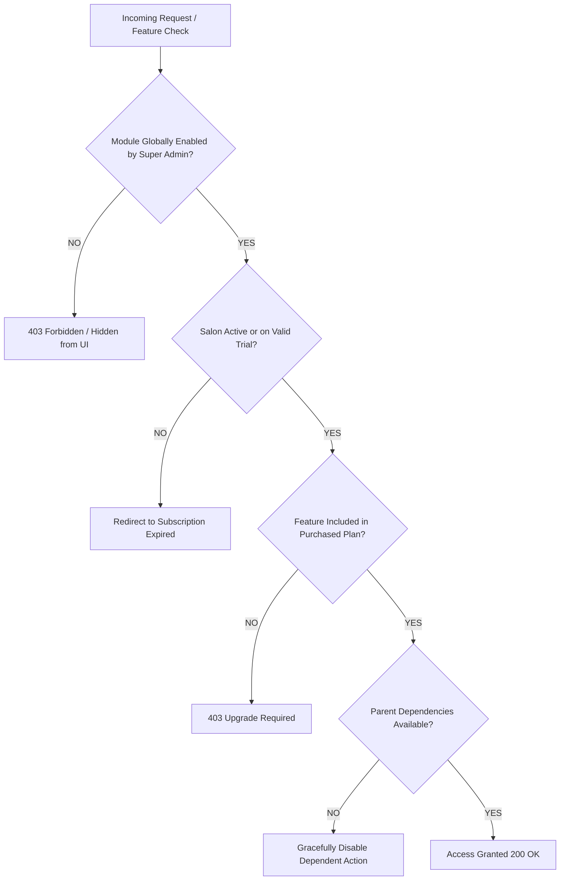

# SAAS SUBSCRIPTION ACCESS & LIFECYCLE AUDIT

**Project:** Salon & Barber SaaS Application  
**Date:** November 25, 2026  
**Audited Models:** `App\Models\Salon`, `App\Models\Subscription`, `App\Models\SubscriptionPlan`  
**Audited Middleware:** `App\Http\Middleware\SubscriptionMiddleware`, `App\Http\Middleware\CheckPlanFeature`

---

## 1. Subscription Lifecycle States & Access Policies

The application manages tenant subscriptions through the `subscriptions` table and the `Subscription` Eloquent model.

| Subscription Status | Platform Access | Module Entitlement Behavior | UI Warning / Prompt | Data Status |
|---|---|---|---|---|
| `trialing` | Granted | All modules globally enabled are accessible | Trial days remaining banner | Read/Write active |
| `active` | Granted | Modules included in the active `plan->features` | Standard dashboard | Read/Write active |
| `past_due` | Granted (Grace) | Entitled plan modules remain accessible during grace period | Warning banner: "Payment past due" | Read/Write active |
| `expired` | Blocked / Restricted | Redirected to `/subscription/expired` | Modal / Full page: "Subscription Expired" | Read-only / Preserved |
| `cancelled` | Restricted | Ends at `ends_at` timestamp; then redirects to renewal | "Subscription Cancelled" | Preserved |
| `suspended` | Blocked | Access denied across all routes | "Account Suspended by Administrator" | Preserved |

---

## 2. Upgrade & Downgrade Behavior

### 2.1 Upgrading a Plan
- When a salon upgrades from a lower tier (e.g., "Basic") to a higher tier (e.g., "Enterprise"):
  1. The new plan's features (e.g. `Inventory Management`, `Multi-Branch Support`, `AI Insights & Automation`) are mapped via `ModuleEntitlementService`.
  2. The salon immediately gains access to newly included modules.
  3. Sidebar links, POS options, and settings tabs reveal the newly unlocked features without requiring user logout.

### 2.2 Downgrading a Plan
- When a salon downgrades to a lower tier:
  1. Features omitted from the new plan (e.g. `Multi-Branch Support`) are immediately restricted.
  2. [SetBranchContext.php](file:///c:/Ketan/projects/barber/app/Http/Middleware/SetBranchContext.php) resets branch context to the primary branch.
  3. Direct route access to excluded modules is blocked with `403 Forbidden` (`errors.feature-locked`).
  4. **Data Preservation Guarantee:** Existing records (historical branches, inventory logs, commission statements, loyalty ledger) are NOT deleted or purged. They remain safely stored in the database for future upgrades or read-only reporting.

---

## 3. Global Override vs Plan Entitlement

A critical flaw previously existed where a module included in a purchased plan remained visible and accessible even when the Super Admin disabled it globally.

### Corrected Architectural Flow:

---

## 4. Security & Tenant Scoping Safeguards

1. **Strict Tenant Boundaries:**  
   Every tenant-facing query continues to enforce `BelongsToSalon` global scopes. Changing URL parameters or payload IDs cannot expose another salon's records.
2. **Server-Side Authorization Invariant:**  
   Frontend checks (`canUseFeature`) serve solely for UI usability. Route middleware (`CheckPlanFeature`, `CheckModuleEnabled`, `permission:*`) strictly enforces server-side validation.
